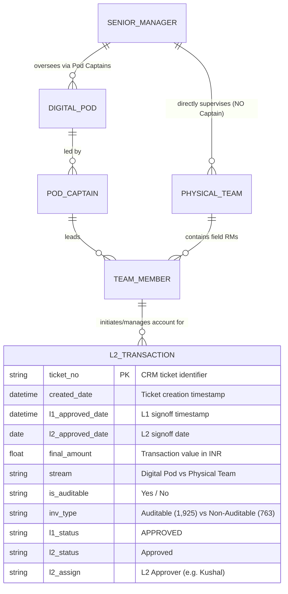

# Architecture Document

## System Overview
The **L2 Dashboard** project provides operational visibility and financial reconciliation into Level 2 (L2) approvals for CenturyJoy / CenturyJoyApp transactions.

## Data Model & Entity Relationship

## Key Entities & Roles
1. **Senior Managers (`Manager` - 4 Executives Only):**
   - **Surajit Laha** (1,029 tickets | ₹13.26 Cr)
   - **Niladri Bhadra** (969 tickets | ₹14.97 Cr)
   - **Arijit Nath** (634 tickets | ₹11.03 Cr)
   - **Amit Singal** (56 tickets | ₹1.24 Cr)
2. **Physical Teams (NO CAPTAIN • Direct Manager Supervision):**
   - `Niladri Bhadra - Physical Team` (492 tickets)
   - `Surajit Laha - Physical Team` (200 tickets)
   - `Arijit Nath - Physical Team` (106 tickets)
   - `Amit Singal - Physical Team` (56 tickets)
3. **Digital Pods (Led by 7 Dedicated Pod Captains):**
   - Shiuli Bhattacharjee, Pallabi Chura, Nasima Banu, Arshi Afreen Jamal, Mousumi Chakraborty, Ranjana Mohajan, Silpa Palchina.
4. **Invoice Audit Compliance PODs:**
   - **Auditable Invoices POD:** 1,925 tickets (₹29.72 Cr | 73.4% revenue share)
   - **Non-Auditable Invoices POD:** 763 tickets (₹10.78 Cr | 26.6% revenue share)
5. **Financial Monetary Bifurcation Matrix:**
   - Replaced raw transaction explorer with executive audit bifurcation across Senior Managers, Streams (Digital vs Physical), 11 Teams, and 8 Approvers.
   - 1-click CSV export of full aggregated audit reconciliation.
6. **L2 Reviewers (`L2 Assign`):** Kushal (Lead/Top volume), Tanmoy, Dhriti, Nabonita, Sayan, Arnab, Manika, Pallabi.
7. **L1 Reviewers (`l1 Approved User`):** Manika Chakraborty, Nandan Saha, Arnab Chakladar, Sayan Banik, Pallabi Banerjee, Arindam Mitra, Subir Halder.
8. **Data Sources:** `CenturyJoy` (Web/Internal) and `CenturyJoyApp` (Mobile).

## Security & Guardrails
- Watermark Protocol: All generated UI components will enforce `"Crafted with ❤️ and Antigravity by KUSHAL KAR"` with hover-only visibility and background integrity kill switch.
- Strict input validation and sanitization on all data transformation layers.
