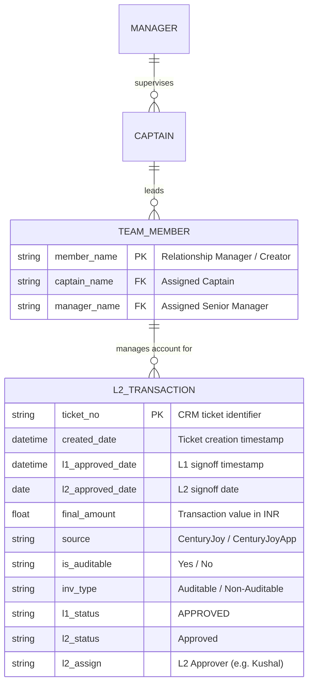

# Architecture Document

## System Overview
The **L2 Dashboard** project provides operational visibility and financial reconciliation into Level 2 (L2) approvals for CenturyJoy / CenturyJoyApp transactions.

## Data Model & Entity Relationship

## Key Entities & Roles
1. **Senior Managers (`Manager`):**
   - Surajit Laha (1,029 tickets | ₹13.26 Cr)
   - Niladri Bhadra (969 tickets | ₹14.97 Cr)
   - Arijit Nath (632 tickets | ₹11.01 Cr)
   - Amit Singal (56 tickets | ₹1.24 Cr)
2. **Captains (`Captains`):** 10 Pod Captains (Niladri Bhadra, Pallabi Chura, Shiuli Bhattacharjee, Nasima Banu, Arshi Afreen Jamal, Surajit Laha, Mousumi Chakraborty, Ranjana Mohajan, Arijit Nath, Amit Singal).
3. **Relationship Managers (`Team Members`):** 84 RMs.
4. **L2 Reviewers (`L2 Assign`):** Kushal (Lead/Top volume), Tanmoy, Dhriti, Nabonita, Sayan, Arnab, Manika, Pallabi.
5. **L1 Reviewers (`l1 Approved User`):** Manika Chakraborty, Nandan Saha, Arnab Chakladar, Sayan Banik, Pallabi Banerjee, Arindam Mitra, Subir Halder.
6. **Data Sources:** `CenturyJoy` (Web/Internal) and `CenturyJoyApp` (Mobile).

## Security & Guardrails
- Watermark Protocol: All generated UI components will enforce `"Crafted with ❤️ and Antigravity by KUSHAL KAR"` with hover-only visibility and background integrity kill switch.
- Strict input validation and sanitization on all data transformation layers.
