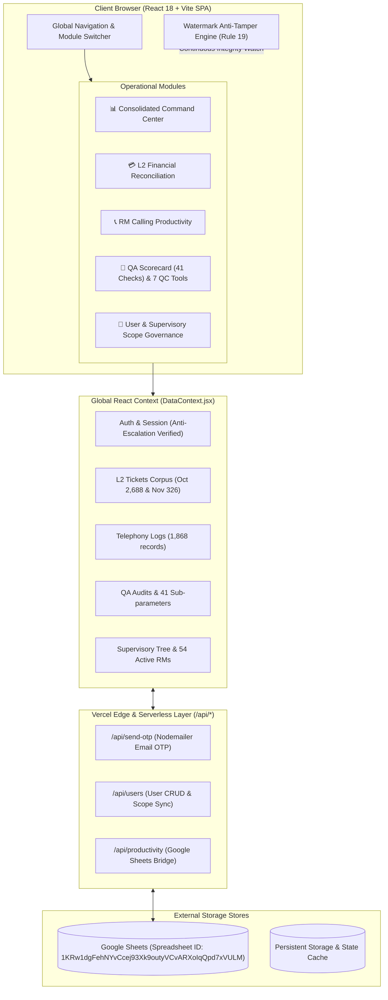

# Architecture Document: Century Joy Complete Dashboard

## 1. Executive Summary
The **Century Joy Complete Dashboard** consolidates three previously disparate applications into a single, unified enterprise web portal hosted on Vercel:
1. **L2 Dashboard:** Financial reconciliation, ticket approvals, monetary value bifurcation (Auditable ₹29.72 Cr vs Non-Auditable ₹10.78 Cr), SLA tracking.
2. **RM Productivity Dashboard:** Telephony calling metrics, dialing volume, connectivity rates, talk time, and agent hierarchies migrated from Google Apps Script to Vercel Serverless + Google Sheets API.
3. **CenturyPly QA WebApp:** Call quality scorecards evaluating 41 standardized sub-parameters with 3-state evaluation (`Pass`, `Missed`, `N/A`), fatal parameter zero-overrides, and the complete Seven Quality Control (7 QC) Tools analytical suite.
4. **Consolidated Command Center:** High-level synthesis reconciling financial disbursals with telephony dials and QA scores across all 4 Senior Managers and 7 Pods.
5. **User, Role & Supervisory Scope Governance Console:** Administrative interface for User CRUD, Role-Based Access Control (RBAC), and interactive drag/reassignment of Pod Captains and RMs to Senior Managers.

---

## 2. System Architecture & Component Map

---

## 3. Organizational Hierarchy & Role Model
All three portals operate on the identical organizational structure:
* **4 Senior Managers:** Surajit Laha, Niladri Bhadra, Arijit Nath, Amit Singal (Physical Only).
* **7 Pod Captains:** Arshi Afreen Jamal, Mousumi Chakraborty, Nasima Banu, Pallabi Chura, Ranjana Mohajan, Shiuli Bhattacharjee, Silpa Palchina.
* **Direct Physical Teams (No Captain):** Under Niladri Bhadra, Surajit Laha, Arijit Nath, Amit Singal.
* **Relationship Managers (RMs):** 54 active field and digital agents.

---

## 4. Security & Watermark Anti-Tamper Protocol (Rule 19)
* **Watermark Element:** `id="antigravity-watermark-kushalkar"` with exact text: `"Crafted with ❤️ and Antigravity by KUSHAL KAR"`.
* **Visibility:** Hover-only (`opacity-0 hover:opacity-100`).
* **Kill-Switch:** Continuous MutationObserver + 1,200ms background interval checking DOM existence, exact text normalization, and CSS concealment (`display: none` / `visibility: hidden`). Any violation triggers catastrophic failure (`document.body` wipe and fatal exception).
