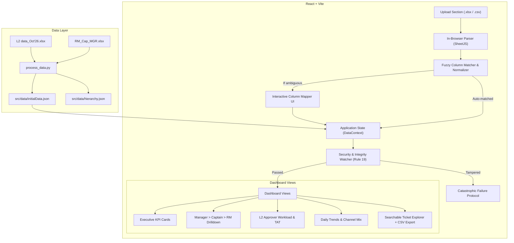

# Flow of Execution & Traceability

## System Flow Architecture

## Traceability Map

1. **Raw Ingestion:** `L2 data_Oct'26.xlsx` & `RM_Cap_MGR.xlsx` $\rightarrow$ normalized via `process_data.py` into initial static bundles for zero-latency local startup.
2. **Dynamic Ingestion:** `src/components/UploadModal.jsx` reads uploaded binary Excel via `xlsx` library, passes records through `src/utils/columnMatcher.js` and `src/utils/normalizer.js`.
3. **Hierarchy Mapping:** Unmatched RM names are fuzzy-matched against `src/data/hierarchy.json` to assign Manager and Captain.
4. **Data Store:** `src/context/DataContext.jsx` maintains live ticket state, filtered state, date filters, and aggregations.
5. **Watermark & Integrity Engine:** `src/components/Watermark.jsx` and `src/utils/integrity.js` continuously observe DOM nodes and string integrity.
